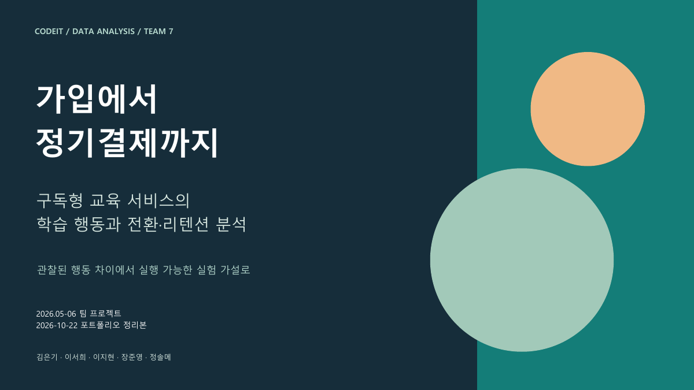
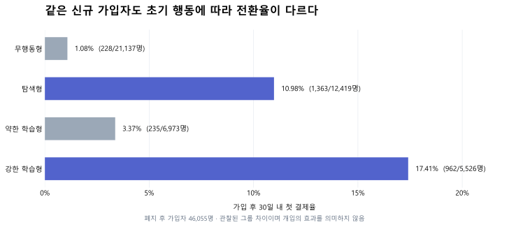

# 구독형 교육 서비스 전환·리텐션 분석

무료체험 폐지 이후, **가입자를 첫 콘텐츠 경험과 결제로 연결하기 위한 행동 기준**을 탐색한 팀 프로젝트입니다.
초기 학습 퍼널과 콘텐츠 개선 우선순위를 분석하고, 온보딩 개선안과 A/B 테스트를 제안했습니다.

| 구분 | 내용 |
|---|---|
| 수행 기간 | 2026.05–06 |
| 형태 | 코드잇 데이터 분석 부트캠프 중급 1 프로젝트 · 7팀 |
| 팀원 | 김은기, 이서희, 이지현, 장준영, 정솔메 |
| 내 역할 | 초기 학습 퍼널, 활성화 기준, 콘텐츠 개선 후보, 유저 세그먼트 분석 · PPT 공동 제작 · 공동 발표 |
| 사용 도구 | Python, pandas, NumPy, Matplotlib, Plotly, SQL |

**바로 보기:** [발표 자료](reports/presentation.pdf) · [핵심 결과 노트북](notebooks/00_key_results.ipynb) · [개인 분석 코드](notebooks/archive/jeehyeon_activation_analysis.ipynb) · [지표 정의](docs/methodology.md)

[](reports/presentation.pdf)

## 어떤 문제를 풀었는가

비교 대상 가입자는 27,543명에서 46,055명으로 증가했지만, 가입 후 30일 내 첫 결제율은 **10.07%에서 6.05%로 낮아졌습니다.**
정책 변경 전후의 차이만으로 원인을 단정할 수 없어, 가입 초기의 콘텐츠 경험과 레슨 완료 행동을 나누어 살펴보았습니다.

## 핵심 분석 결과

폐지 후 가입자 46,055명을 대상으로, 최종 팀 노트북의 4개 세그먼트를 데이터 마트에서 다시 집계했습니다.

| 세그먼트 | 기준 | 유저 수 | 첫 결제자 수 | 30일 내 첫 결제율 |
|---|---|---:|---:|---:|
| 무행동형 | 콘텐츠 경험 없음 · 결제 전 레슨 완료 0회 | 21,137 | 228 | **1.08%** |
| 탐색형 | 콘텐츠 경험 있음 · 결제 전 레슨 완료 0회 | 12,419 | 1,363 | **10.98%** |
| 약한 학습형 | 결제 전 레슨 완료 1–6회 | 6,973 | 235 | **3.37%** |
| 강한 학습형 | 결제 전 레슨 완료 7회 이상 | 5,526 | 962 | **17.41%** |



- **레슨 완료가 없어도 콘텐츠 경험에 따라 결제율 차이가 관찰됐습니다.** 무행동형을 첫 콘텐츠 경험으로 연결하는 온보딩을 우선 실험 대상으로 제안했습니다.
- **레슨 완료 7회 이상을 활성화 후보 기준으로 삼았습니다.** 결제율과 대상 유저 규모를 함께 고려한 탐색적 기준이며, 7회 달성의 인과 효과를 입증한 결과는 아닙니다.
- **콘텐츠 개선 후보를 규모와 미완료율로 비교했습니다.** 조회 대비 시작률이 100%를 넘는 로그 특성을 확인해, 해당 비율 하나로 콘텐츠 품질을 판단하지 않았습니다.

여기서 ‘무행동형’은 모든 서비스 활동이 없는 사람이 아니라 위 분류 기준에 해당하는 유저입니다. 콘텐츠 경험에는 가입 후 7일 전체의 조회·시작 변수가 사용되므로, 조기 결제자의 결제 후 행동이 포함될 수 있습니다. 이 결과는 **관찰된 그룹 차이**로 해석합니다.

## 내 기여

1. 유저·콘텐츠·이벤트 로그의 정의와 가입 후 7일 기준 분석 흐름을 점검했습니다.
2. 레슨 페이지 진입부터 완료까지의 퍼널을 살펴보고, 첫 레슨 완료 여부에 따른 후속 행동을 비교했습니다.
3. 레슨 완료 수와 결제율·유저 규모를 함께 보며 활성화 기준 후보를 탐색했습니다.
4. 레슨 진입 후 미완료 유저와 beginner 콘텐츠의 개선 우선순위를 분석했습니다.
5. 콘텐츠 난이도 이동, 할인율과 첫 결제율의 관계, 행동 세그먼트를 분석했습니다.
6. 팀원들과 발표 자료를 공동 제작하고, 팀원 1명과 최종 발표를 나누어 진행했습니다.

개인 노트북은 팀 통합본에서 **‘Appendix B. 이지현 팀원 개별 분석 원본’**으로 표시된 구간을 추출했습니다. 팀 전체 결과와 개인 수행 범위는 [기여 범위](docs/contribution.md)에 구분했습니다.

## 제안한 실행 방향

| 대상 | 제안 | 확인할 지표 |
|---|---|---|
| 첫 콘텐츠 경험이 없는 신규 유저 | beginner 추천 콘텐츠와 원클릭 시작 CTA | 가입 후 7일 콘텐츠 경험률, 30일 내 첫 결제율 |
| 레슨 완료 1–6회 유저 | 다음 학습 안내와 동기부여 메시지 | 7회 이상 완료율, 첫 결제율 |
| 첫 결제자 | 반복 방문과 학습 루틴을 돕는 장치 | 학습 활동일수, 관찰기간을 통일한 갱신율 |

A/B 테스트와 기대 매출은 **설계·시뮬레이션 단계**입니다. 실제 배포 후 전환율이나 매출이 상승했다고 주장하지 않습니다. [실험 설계](docs/experiment-design.md)에서 세그먼트 이동 가정과 실험의 검출 목표를 구분했습니다.

## 첫 결제 이후의 갱신

팀은 첫 결제 이후 학습 활동일수와 갱신의 관계도 분석했습니다. 공개본은 **무료체험 폐지 후 유저 중 60일 관찰이 가능한 3,323명**으로 모집단을 통일했습니다.

| 학습 활동일수 | 대상 유저 | 60일 내 갱신 유저 | 갱신율 |
|---|---:|---:|---:|
| 0–4일 | 905 | 440 | **48.62%** |
| 5–13일 | 1,234 | 737 | **59.72%** |
| 14일 이상 | 1,184 | 759 | **64.10%** |

활동일수가 높은 그룹에서 갱신율도 높게 관찰됐습니다. 이는 학습 루틴을 돕는 개선안을 제안하는 근거이며, 학습일수를 늘리면 갱신이 증가한다는 인과 검증은 아닙니다.
활동일수는 제공 마트의 집계값을 사용합니다. 원본 필드에는 최대 32일이 포함되어 있어 정확한 ‘결제 후 30일’ 대신 **‘결제 후 학습 활동일수’**로 표기했습니다. 상세 정의와 기존 발표 대비 변경은 [정정 이력](docs/review-notes.md)에 기록했습니다.

## 데이터와 재현

- 첫 결제 분석 가입 기간: 폐지 전 **2022년 5–11월**, 폐지 후 **2023년 5–11월**.
- 확인한 마트: 유저 73,598행, 콘텐츠 1,060행, 갱신 5,201행.
- 데이터 출처 맥락: 부트캠프 팀 프로젝트에서 사용한 교육 서비스 로그와 분석 마트. 실제·합성 여부와 재배포 조건은 제공 자료에서 확정하지 않았습니다.
- 원시 로그와 유저 단위 CSV는 이 저장소에 포함하지 않습니다. [스키마](data/schema.json)와 집계 결과를 제공합니다.
- 원자료를 가진 사람은 아래 명령으로 핵심 집계를 다시 계산할 수 있습니다. Python 표준 라이브러리만 사용합니다.

```bash
python scripts/reproduce_key_metrics.py --data-dir "원본 마트 폴더" --output results/key_metrics.json
```

필수 파일은 `dm_user_activation_payment.csv`, `dm_user_subscription_retention_core.csv`입니다.
이 명령은 **마트에서 핵심 수치를 재집계**합니다. 원시 이벤트에서 마트를 새로 만드는 작업, 전체 노트북 순차 실행, 실험 효과 검증까지 수행하는 명령은 아닙니다.
노트북의 실행 범위와 입력 파일은 [실행 안내](docs/reproduction.md)를 확인해 주세요.

## 파일 구성

```text
reports/     수치와 표현을 교정한 발표 자료
notebooks/   핵심 결과 요약 및 개인·팀 탐색 기록
scripts/     핵심 지표 재집계
results/     검증한 집계 결과
assets/      결과 요약 그래프
data/        스키마와 입력 안내
sql/         교정한 조회자 결제율 쿼리 및 공용 팀 SQL 기록
docs/        분석 기준, 개인 기여, 재현 범위, 수정 근거
```

## 해석의 한계

- 전후 비교에는 유입 채널·유저 구성·계절·상품 정책의 차이가 섞일 수 있습니다.
- 행동과 결제의 연관성이 행동 유도에 따른 전환 상승을 보장하지는 않습니다.
- 일부 행동 변수의 관찰창이 다릅니다. 향후 사전 행동만으로 정의를 통일해 재분석할 필요가 있습니다.
- 조회·시작 로그의 수집 경로가 달라 단순 퍼널 비율을 해석할 때 주의가 필요합니다.
- 플랜별 갱신 구조와 활동일수의 정확한 시간 경계는 결제 정책 및 갱신 마트 생성 쿼리를 추가 확인해야 합니다.

[전체 포트폴리오로 이동](https://github.com/lucyjeehyeon/portfolio)
